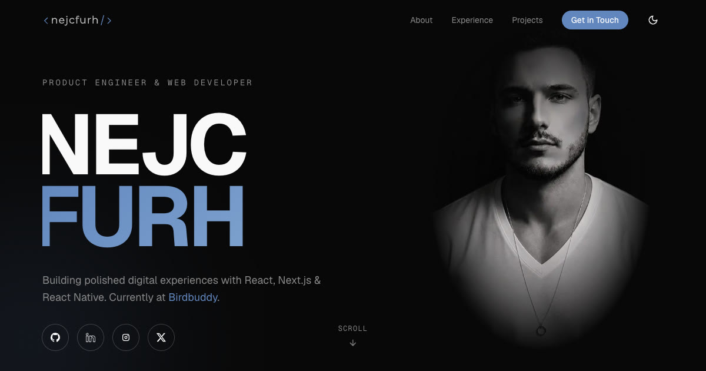

<div align="center">

<a href="https://www.nejcfurh.dev">
  
</a>

<h1>nejcfurh.dev</h1>

<p><strong>Personal portfolio of Nejc Furh — product engineer &amp; web developer.</strong></p>

<p>
  <a href="https://www.nejcfurh.dev"></a>
  <a href="https://github.com/nejcfurh/nejcfurh-dev/actions/workflows/ci.yml"></a>
  
  
  
  
</p>

<p>
  <a href="#getting-started">Getting started</a> ·
  <a href="#tech-stack">Tech stack</a> ·
  <a href="#project-structure">Structure</a> ·
  <a href="#configuration">Configuration</a> ·
  <a href="#deployment">Deployment</a>
</p>

</div>

---

## Overview

A single-page portfolio built with the Next.js App Router. It scrolls through **Hero → About → Experience → Projects → Contact**, with smooth Lenis scrolling, scroll-driven Motion animations and a responsive layout from phone to desktop.

<table>
  <tr>
    <td width="50%" valign="top">
      <h4>Motion</h4>
      Lenis smooth scroll, scroll-triggered reveals, and a scroll progress bar. Drone clips load only when they near the viewport.
    </td>
    <td width="50%" valign="top">
      <h4>Light &amp; dark theme</h4>
      A theme toggle with a circular reveal. The saved theme is restored before first paint, so the page never flashes.
    </td>
  </tr>
  <tr>
    <td width="50%" valign="top">
      <h4>Live project previews</h4>
      Project cards open a preview modal. The Birdbuddy Year in Review runs inside it as a lazy-loaded, story-style feature.
    </td>
    <td width="50%" valign="top">
      <h4>Contact form</h4>
      Validated before sending, delivered through EmailJS from the browser, with toast feedback.
    </td>
  </tr>
  <tr>
    <td width="50%" valign="top">
      <h4>Analytics</h4>
      PostHog page views and a <code>ButtonTap</code> event on every button, off in development.
    </td>
    <td width="50%" valign="top">
      <h4>SEO</h4>
      <code>robots.txt</code>, a sitemap and Open Graph / social share metadata.
    </td>
  </tr>
</table>

## Getting Started

> [!NOTE]
> Requires **Node.js 22** (the version CI uses) and npm.

```bash
npm ci
```

```bash
cp .env.example .env.local
```

```bash
npm run dev
```

The site runs at <http://localhost:3000>. Every variable in `.env.example` is optional. [Configuration](#configuration) says what each one turns on.

### Scripts

| Command | What it does |
| --- | --- |
| `npm run dev` | Start the dev server with Turbopack. |
| `npm run build` | Create a production build. |
| `npm run start` | Serve the production build. |
| `npm run lint` | Run ESLint. |
| `npm run typecheck` | Generate route types, then run `tsc --noEmit`. |

## Tech Stack

| Area | Tools |
| --- | --- |
| **Framework** | [Next.js 16](https://nextjs.org) (App Router, Turbopack), [React 19](https://react.dev) |
| **Language** | [TypeScript 6](https://www.typescriptlang.org) |
| **Styling** | [Tailwind CSS 4](https://tailwindcss.com), Geist, Inter and Awesome Serif fonts |
| **Animation** | [Motion](https://motion.dev), [Lenis](https://lenis.darkroom.engineering) |
| **Stories** | react-insta-stories (Year in Review) |
| **Icons** | Lucide React, React Icons |
| **Contact** | [EmailJS](https://www.emailjs.com) (browser SDK), react-hot-toast |
| **Analytics** | [PostHog](https://posthog.com) (posthog-js) |
| **Tooling** | ESLint 10, GitHub Actions |

## Project Structure

```text
app/
├── analytics/                    # PostHog provider, page-visit tracker, ButtonTap hook
├── components/                   # Shared UI: logo, scroll progress, grain overlay
│   ├── motion/                   #   Animated text, sections, background video
│   └── theme/                    #   Theme provider and toggle
├── config/                       # App config (PostHog) and site URL
├── features/
│   ├── homepage/                 # Navbar, Hero, About, Experience, Projects, Contact, Footer
│   └── personal-year-in-review/  # Story-style Year in Review shown in the project preview
├── hooks/                        # useMediaQuery, useIsMounted
├── layout.tsx                    # Fonts, theme init script, providers, metadata
├── page.tsx                      # The single page
├── robots.ts
└── sitemap.ts
public/                           # Images, drone videos, fonts, CV
```

## Configuration

### Analytics

PostHog is wired up in `app/analytics`, configured from `app/config/app.config.ts` and mounted in the root layout. Page views are sent by `PageVisitTracker` rather than by PostHog's automatic capture, so each event carries its own page name.

| Variable | Purpose |
| --- | --- |
| `NEXT_PUBLIC_POSTHOG_KEY` | PostHog project API key. Analytics stay off while this is unset. |
| `NEXT_PUBLIC_POSTHOG_HOST` | PostHog ingest host: `https://eu.i.posthog.com`. The project is on EU cloud, so the key is rejected by the US host. |
| `NEXT_PUBLIC_ENV` | `development`, `staging`, `preview` or `production`. PostHog is only initialised, and events only sent, outside `development`. |
| `NEXT_PUBLIC_VERSION` | Reported as the `Version` super property. Falls back to the short Vercel commit SHA, then `dev`. |

### Contact Form

The contact form sends through EmailJS from the browser. While any of these is unset, submitting shows a "not configured" toast instead of sending.

| Variable | Purpose |
| --- | --- |
| `NEXT_PUBLIC_EMAILJS_SERVICE_ID` | EmailJS service ID. The older `NEXT_PUBLIC_MAILJS_SERVICE_ID` name is still read as a fallback. |
| `NEXT_PUBLIC_EMAILJS_TEMPLATE_ID` | EmailJS template ID. |
| `NEXT_PUBLIC_EMAILJS_PUBLIC_KEY` | EmailJS public key. |

## Deployment

The site is deployed on **Vercel**. The apex domain redirects to `www.nejcfurh.dev`, which is the canonical host for URLs, the sitemap and social cards.

Every pull request and every push to `master` runs **lint → typecheck → build** in [GitHub Actions](.github/workflows/ci.yml).

---

<div align="center">
  <sub>Built by <a href="https://www.nejcfurh.dev">Nejc Furh</a></sub>
</div>
